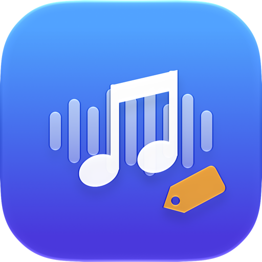
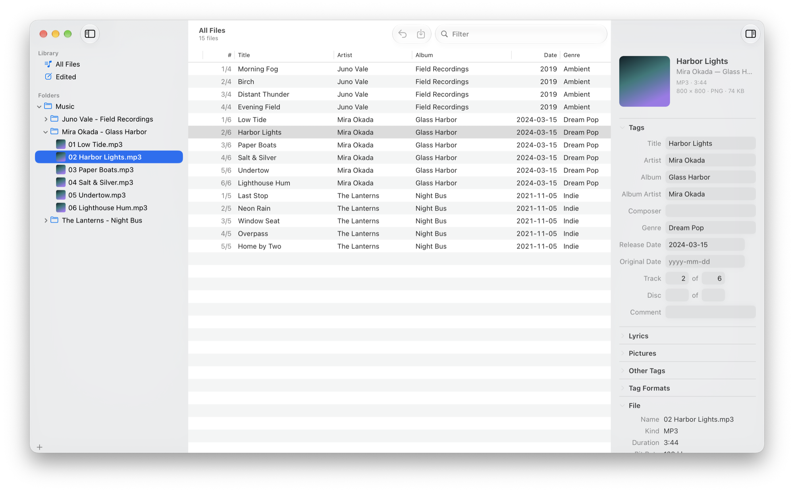

<div align="center">
  
  <h1>AudioTag</h1>
  <p>Audio metadata editor for macOS powered by TagLib<br /></p>

[](https://www.gnu.org/licenses/agpl-3.0.en.html)

</div>



## Features

- Native user interface built with [AppKit](https://developer.apple.com/documentation/appkit),
  with a Liquid Glass app icon.
- Every format [TagLib](https://taglib.org) reads, through
  [TagLib-Swift](https://github.com/OtoFlow/TagLib-Swift): MP3, FLAC, MP4 (AAC, ALAC), Ogg
  Vorbis, Opus, APE, WavPack, WAV, AIFF, DSF, Matroska and more.
- Edit the tags of many files at once: a field shows whether the files share its value, and
  editing it gives them all the same.
- Edit in the list as in a spreadsheet: Return moves to the same field of the next file, Tab
  to the next field.
- Every tag a file holds, not just the common ones, such as `ISRC` or MusicBrainz IDs.
- Full release and original dates, down to the day or the minute, typed in any common form
  and saved as ISO 8601, with a note where a file's tag format keeps less of them.
- Artwork, dropped, pasted or chosen, and every picture a file holds, with its kind and
  description.
- Track and disc numbers written as each format records them: `3/12` in ID3v2 and MP4
  tags, `TRACKNUMBER` and `TRACKTOTAL` in Vorbis comments.
- Choose the tag formats files are saved in, such as ID3v2, ID3v1 and APE for MP3 files, and
  the ID3v2 version, and see the items each format stores.
- Browse folders with each file's artwork, and rename, move and trash files and folders,
  with undo.
- Edits are kept until saved, and all the files edited are listed together to review.
- Sandboxed: AudioTag reaches only the folders and files you give it, and remembers them.

## Using AudioTag

The window shows your folders in a sidebar, the audio files of the one selected in a list,
and an inspector of the files selected:

- **Library** lists all the files of your folders, and those edited and not yet saved.
- **Folders** lists the folders you added with **+** or **File › Open…**, or dropped onto the
  window, with their subfolders and audio files. Audio files opened on their own are listed
  under **Opened Files**.
- The inspector shows the files' artwork, then their tags, lyrics, pictures, other tags, tag
  formats and audio properties, in sections that can be collapsed.

Edits apply as you type, and are saved when you choose **File › Save**.

| Shortcut | |
| --- | --- |
| <kbd>⌘</kbd> <kbd>S</kbd> | Save every file edited |
| <kbd>⌘</kbd> <kbd>O</kbd> | Add folders or open files |
| <kbd>⌘</kbd> <kbd>F</kbd> | Filter the list |
| <kbd>Return</kbd>, <kbd>⇧</kbd> <kbd>Return</kbd> | In the list, save the field and edit it in the next file, or the one before |
| <kbd>Tab</kbd>, <kbd>⇧</kbd> <kbd>Tab</kbd> | In the list, edit the next field, or the one before |
| <kbd>Esc</kbd> | Discard the change to the field being edited |
| <kbd>Return</kbd> | In the sidebar, rename the file or folder selected |
| <kbd>⇧</kbd> <kbd>⌘</kbd> <kbd>N</kbd> | New folder |
| <kbd>⌘</kbd> <kbd>⌫</kbd> | Move to Trash |
| <kbd>⌘</kbd> <kbd>Z</kbd> | Undo a rename, move, new folder or trash |
| <kbd>⌘</kbd> <kbd>R</kbd> | Reload the folder |
| <kbd>⌃</kbd> <kbd>⌘</kbd> <kbd>S</kbd>, <kbd>⌥</kbd> <kbd>⌘</kbd> <kbd>I</kbd> | Show or hide the sidebar, or the inspector |

## Requirements

- macOS 14.0 (or newer)
- Xcode 26.0 (or newer), for the Swift 6 toolchain and the Icon Composer app icon

## Building

### Get the Code

TagLib-Swift is a submodule, which has TagLib as a submodule of its own:

```bash
git clone --recurse-submodules https://github.com/foyoodo/AudioTag.git
# or, in an existing checkout
git submodule update --init --recursive
```

### Install the Tools

[Mise](https://github.com/jdx/mise) installs the versions of [Tuist](https://github.com/tuist/tuist)
and swift-format that `mise.toml` names:

```bash
brew install mise   # if you don't have it
mise install        # in the project folder
```

### Generate the Workspace

```bash
tuist install
tuist generate --cache-profile none
```

### Build and Run

Open `AudioTag.xcworkspace`, then <kbd>⌘</kbd> <kbd>R</kbd>. <kbd>⌘</kbd> <kbd>U</kbd> runs
the tests.

## CI builds

GitHub Actions builds two ad-hoc-signed packages on every push to `main`, pull
request, manual run, and version tag (`v*`):

- **AudioTag-arm64** — Apple Silicon
- **AudioTag-universal** — Apple Silicon and Intel (`arm64` + `x86_64`)

Download the zip or disk image from the workflow run's artifacts. On a `v*` tag
the same files are attached to the [GitHub Release](https://github.com/foyoodo/AudioTag/releases).
The builds are not notarized. After moving the app to `/Applications`, allow it
in **System Settings › Privacy & Security › Open Anyway**, or clear the
quarantine attribute:

```bash
xattr -dr com.apple.quarantine /Applications/AudioTag.app
```

## Contributing

Format the code with swift-format, as `.swift-format` configures it, before committing:

```bash
swift-format format -i -r --configuration .swift-format AudioTag
swift-format lint -r --configuration .swift-format AudioTag
```

## License

AudioTag and its components are licensed under the
[AGPL v3](https://www.gnu.org/licenses/agpl-3.0.en.html).
